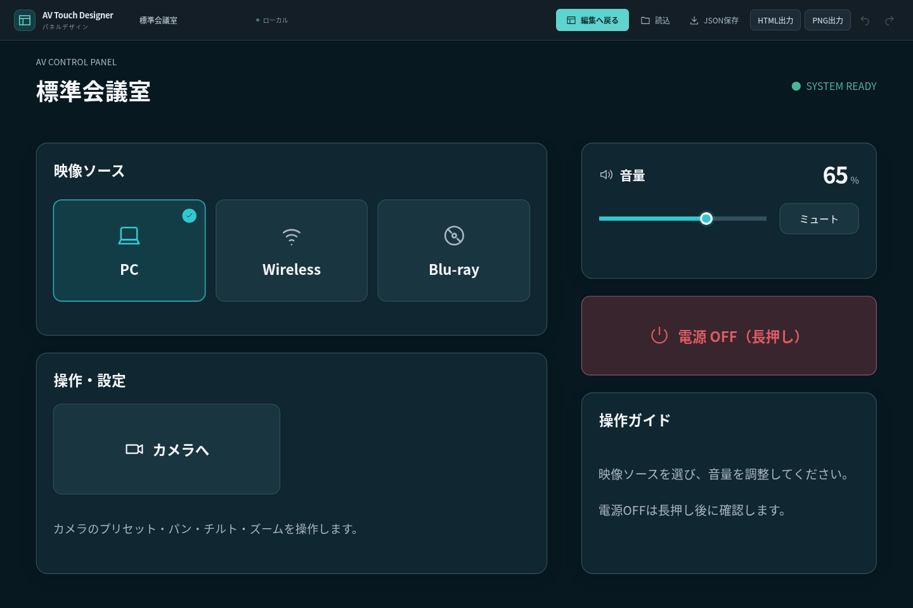
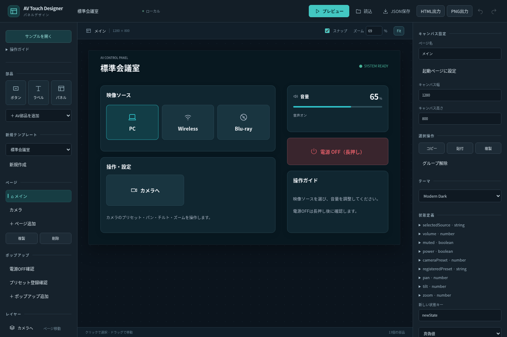

# AV Touch Designer 試用版（デザイン改訂版）

共有モックを参考に、濃紺とシアン、用途別カード、大きなラインアイコンへ改訂しました。

[ZIPをダウンロード](AV-Touch-Designer-trial.zip)して展開し、`AV-Touch-Designer.html`をChromeまたはEdgeで開きます。

1. 標準会議室が開きます。部品を選択・ドラッグし、右側で文字や寸法を編集します。
2. 「プレビュー」で入力選択・音量・カメラ・電源の模擬操作を試せます。
3. 編集を残すときは「JSON保存」、再開は「読込」を使います。

インストールやサーバー起動は不要です。ZIPにはHTML・使い方・ライセンス・サンプルJSONを同梱しています。外部通信・実機制御・クラウド保存は行いません。

Linux Chromiumの通信遮断した文書で、編集・保存・読込・HTML／PNG出力を検証しています。Windows Chrome/Edgeでのfile URL直接起動は未検証です。
